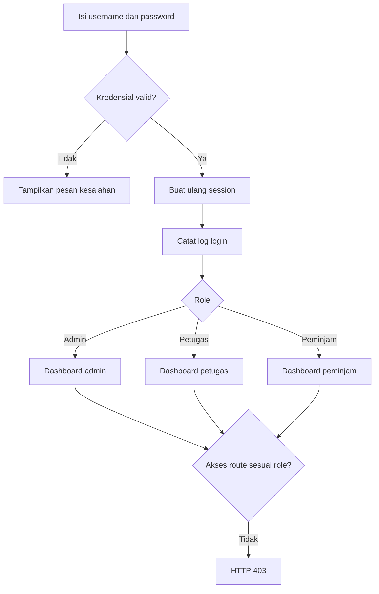
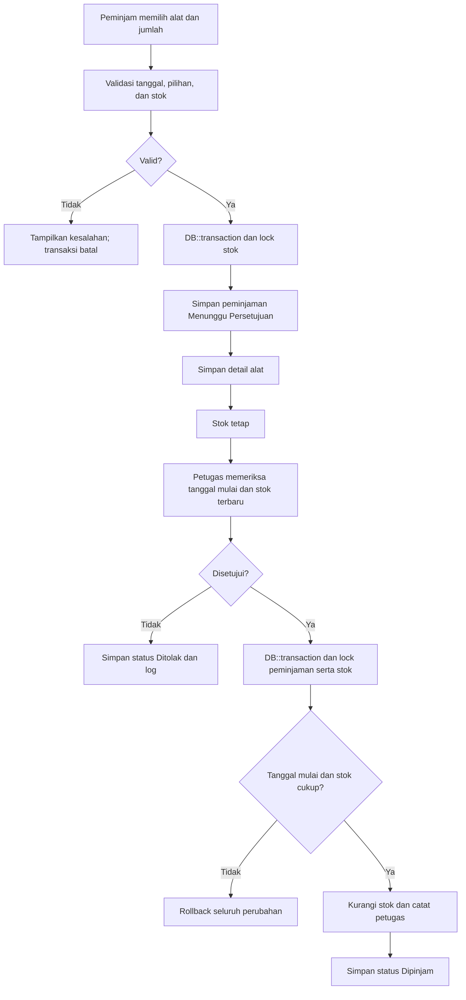
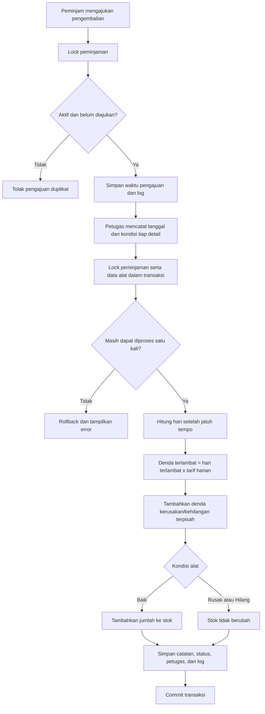

# Alur dan Dokumentasi Modul

## Alur login dan role

Logout mencatat log, mengakhiri guard, menginvalidasi session, lalu menghasilkan CSRF token baru.

## Alur pengajuan dan persetujuan

## Alur pengembalian dan denda

Tarif harian dibaca dari `config/peminjaman.php`. Perhitungan dimulai pada tanggal setelah `tanggal_kembali_rencana`; denda kerusakan/kehilangan diwajibkan jika kondisi detail bukan `Baik`.

## Dokumentasi modul

| Modul | Input | Proses | Output | Controller / method |
|---|---|---|---|---|
| Login/logout | Username, password | Autentikasi, regenerasi/invalidate session, catat log | Dashboard sesuai role / kembali ke login | `Admin\LoginLogoutController@login`, `logout` |
| User | Nama, email, username, role, password | Validasi unik, Hash password, cegah penghapusan akun/transaksi yang masih dipakai | Daftar dan akun tersimpan | `Admin\UserController` CRUD |
| Kategori | Nama, deskripsi | Validasi unik dan cegah hapus kategori yang masih dipakai | Kategori alat | `Admin\KategoriController` CRUD |
| Alat | Nama, kategori, kode, stok, kondisi, foto | Validasi stok dan kategori; cegah hapus alat yang punya detail transaksi | Inventaris/katalog | `Admin\DataAlatController` CRUD |
| Pengajuan peminjaman | Daftar alat, jumlah, tanggal pinjam/rencana kembali | Validasi batas stok, transaction, simpan status menunggu tanpa mengurangi stok | Peminjaman dan detail | `Admin\PeminjamanController@ajukanPeminjaman` |
| Persetujuan | ID peminjaman | Kunci transaksi/stok, validasi tanggal mulai dan stok, kurangi stok atau tolak | Status dan petugas persetuju | `Admin\PeminjamanController@approve`, `reject` |
| Pengajuan pengembalian | ID peminjaman milik peminjam | Kunci peminjaman dan mencegah pengajuan ganda | Timestamp pengajuan untuk petugas | `Admin\PeminjamanController@ajukanPengembalian` |
| Proses pengembalian | Tanggal, kondisi tiap detail, denda kerusakan, catatan | Lock data, hitung denda, update stok hanya untuk alat baik, tulis log dalam transaksi | Status dan rincian pengembalian | `Admin\PengembalianController@store` |
| Laporan transaksi | Status, rentang tanggal | Query database peminjaman/pengembalian dan eager load relasi | Tabel lengkap yang dapat dicetak | `Auth\Petugas\CetakLaporanController@index` |
| Log aktivitas | Tidak ada input | Ambil log terbaru dan nama pengguna | Tabel log terpaginasikan | `Admin\LogAktivitasController@index` |
